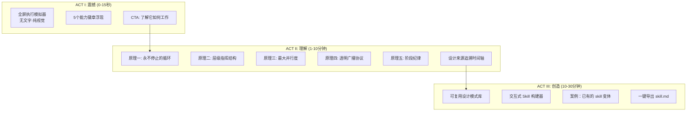
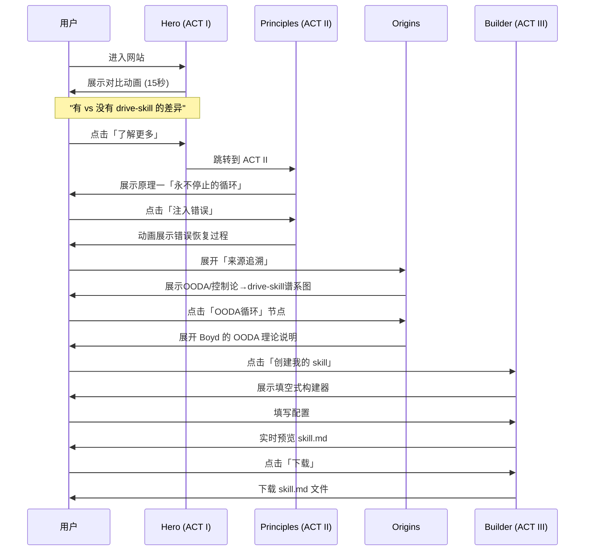

# Drive Showcase V2: 交互式视觉教学平台架构设计

> 版本: 1.0 | 日期: 2026-03-01 | 作者: Claude Architect

---

## Executive Summary

**是什么**：将现有的 drive-skill 展示网站从"静态文档站"升级为"交互式学习平台"——让任何人通过"看→理解→追溯→创建"四步路径，15秒内被震撼，5分钟内理解原理，30分钟内能够创建自己的 drive-skill 类技能。

**为什么**：现有 18 section 展示站内容全面但体验断层——内容是静态的，原理是隐含的，路径是线性的。新访客进来找不到入口，老用户找不到"如何创建自己版本"的出路。

**怎么做**：三幕戏剧结构 + 可探索叙事技术。整个网站是一次有设计的旅程，而不是一本手册。每个核心概念都配备可交互的微型演示，而不是静态文字。

---

## 设计哲学

```
传统思路：解释 → 展示 → 使用
新架构：震撼 → 好奇 → 理解 → 行动
```

三条核心原则：
1. **Show, Don't Tell**：所有关键概念用动态可视化，不用文字叙述
2. **Layered Depth**：外层简单（15秒看懂），内层深度（30分钟入门）
3. **Make it Actionable**：每看完一部分，都有明确的"你现在可以做什么"

---

## 系统图：三幕结构



---

## 详细组件规格

### 组件一：ExecutionSimulator（核心新组件）

**职责**：用动画模拟一次完整的 drive-skill 执行过程，是整个网站的"心脏"。

**状态机设计**：
```typescript
type SimulatorState = {
  phase: 'idle' | 'phase0' | 'phaseT' | 'phase1' | 'loop' | 'complete';
  agents: Agent[];        // 当前存活的agent节点
  messages: Message[];    // 消息流
  tasks: Task[];          // 任务列表
  currentWave: number;    // 当前执行波
  metrics: {
    wallClockTime: number;
    parallelWidth: number;
    tasksCompleted: number;
  };
};

type SimulatorControls = {
  play: () => void;
  pause: () => void;
  stepForward: () => void;
  jumpToPhase: (phase: Phase) => void;
  setSpeed: (multiplier: 1 | 2 | 5 | 10) => void;
  injectError: () => void;  // 注入错误，展示恢复能力
};
```

**可视化层次**：
1. **拓扑层**（SVG）：实时渲染 agent 节点图，节点随阶段动态创建/销毁
2. **消息层**（Canvas）：消息包沿连接线运动（DISPATCH=金色, RETURN=绿色, BROADCAST=紫色）
3. **时间轴层**（HTML）：底部显示任务波次和关键路径
4. **指标层**（HTML）：右侧实时显示 wall-clock time, parallelism width

**对比模式**（ACT I 的关键体验）：
```
┌─────────────────────────────────────────────────────────────┐
│                                                             │
│   WITHOUT drive-skill          WITH drive-skill             │
│   ─────────────────           ──────────────────           │
│   [Sequential agent]          [STL orchestration]          │
│   Task 1 ████████             Task 1 ████                   │
│   Task 2         ████         Task 2 ████                   │
│   Task 3             ████     Task 3 ████                   │
│   Total: 12s                  Task 4 ████                   │
│                               Total:  4s  ← 3x faster      │
│                                                             │
└─────────────────────────────────────────────────────────────┘
```

---

### 组件二：OriginTrace（设计来源追溯）

**职责**：追溯 drive-skill 每个设计决策背后的思想来源，建立"设计师的认知地图"。

**信息架构**：

```
Drive Skill 的思想谱系
│
├── 永不停止的循环 (The Cardinal Rule)
│   ├── 控制论 (Cybernetics, Norbert Wiener, 1948)
│   │   └── "自我调节系统通过反馈维持目标"
│   ├── OODA 循环 (Boyd, 1970s)
│   │   └── "Observe → Orient → Decide → Act，速度即优势"
│   └── 精益制造 (Toyota, 1950s)
│       └── "流动永不中断，问题是改进机会"
│
├── 层级指挥结构 (STL Hierarchy)
│   ├── 军事指挥链 (Mission Command, 普鲁士军事)
│   │   └── "权限下放，意图上传，执行自主"
│   ├── 中台战略 (阿里巴巴, 2015)
│   │   └── "中台协调，前台自治"
│   └── 复杂适应系统 (Santa Fe Institute)
│       └── "涌现行为来自局部规则，不需要中央控制"
│
├── 最大并行度 (Swarm-First)
│   ├── 克里蒂克路径法 (CPM, 1957)
│   │   └── "找最长串行链，最小化关键路径"
│   ├── 蚁群算法 (Dorigo, 1992)
│   │   └── "并行探索 > 串行搜索"
│   └── Amdahl 定律 (1967)
│       └── "并行加速受制于串行比例"
│
├── 透明广播协议 (Broadcast)
│   ├── 信息论 (Shannon, 1948)
│   │   └── "可见性降低不确定性，降低熵"
│   ├── 敏捷每日站会
│   │   └── "持续同步，防止信息孤岛"
│   └── 军事作战室 (War Room)
│       └── "所有状态可见，决策有据可查"
│
└── 阶段纪律 (Phase Discipline)
    ├── 孙子兵法 "谋定而后动"
    ├── 双钻模型 (Design Council, 2004)
    └── OODA 的 Orient 阶段
```

**可视化形式**：
- 交互式关系图（力导向布局）
- 点击每个来源节点展开该思想的简短说明
- 显示"这个思想如何体现在 drive-skill 的具体代码/规则中"

---

### 组件三：PrincipleCards（五大原理卡片）

每张原理卡片的结构：

```
┌─────────────────────────────────────────────────────────────┐
│  原理名称                                    [展开演示 →]   │
│  一句话概括                                                  │
│  ─────────────────────────────────────────────────────────  │
│  │  内嵌微型演示（可交互）                                 │
│  │  ┌─────────────────────────────────────┐               │
│  │  │  [此处是 animated demo]              │               │
│  │  │  用户可以操控这个演示                │               │
│  │  └─────────────────────────────────────┘               │
│  │                                                          │
│  │  思想来源: [来源标签] → [来源标签] → drive-skill         │
│  │                                                          │
│  │  drive.md 中的体现: [高亮代码段]                        │
│  │                                                          │
│  │  可复用模板: 如果你要设计自己的 skill,可以这样用...      │
│  └─────────────────────────────────────────────────────────│
└─────────────────────────────────────────────────────────────┘
```

**五大原理及其微型演示**：

| 原理 | 微型演示 | 交互 |
|------|---------|------|
| 永不停止的循环 | 三个循环路径对比：传统串行等待 vs drive循环 | 点击"注入错误"看恢复 |
| 层级指挥（STL） | 可点击的层级节点树，展示 1 STL = 4x 吞吐量 | 拖拉节点分配到 STL |
| 最大并行度 | 关键路径计算器：给5个任务，拖动排列看时间变化 | 拖拉任务调整依赖关系 |
| 广播协议 | 消息流动画：有广播 vs 无广播的可见性对比 | 切换"广播开/关" |
| 阶段纪律 | 时间投资计算器：Phase0花10分钟节省多少返工 | 调整Phase0时间看ROI |

---

### 组件四：SkillBuilder（DIY 技能构建器）

**核心价值**：这是让用户从"理解"到"创建"的桥梁。

**设计模式**：填空 + 选择 + 预览

```
CREATE YOUR OWN SKILL
─────────────────────────────────────────────────────────────

STEP 1: 定义你的技能名称和触发词
  名称: [________________]
  触发词: [________________] (e.g., "drive", "analyze", "build")
  一句话描述: [________________________________________________]

STEP 2: 选择执行模型
  ○ 单一 Agent (适合简单任务)
  ● 层级 Swarm (适合复杂多步骤)      ← 推荐
  ○ Pipeline (适合有依赖的流水线)
  ○ 自定义

STEP 3: 配置阶段
  ✓ Phase 0: 调研阶段       [描述: _______________________]
  ✓ Phase 1: 规划阶段       [描述: _______________________]
  ○ Phase T: 团队组建        [描述: _______________________]
  ○ 自定义阶段               [+ 添加阶段]

STEP 4: 配置决策规则
  永不停止规则: ✓ 启用
  广播协议:    ✓ 每次dispatch/return都广播
  方向验证:    ○ 在关键决策点要求用户确认

STEP 5: 配置工具权限
  ✓ Bash  ✓ Read  ✓ Write  ✓ Edit  ✓ Glob  ✓ Grep
  ✓ WebSearch  ✓ WebFetch  ✓ Task
  ○ TeamCreate  ○ SendMessage  (高级功能)

                              [ 预览 skill.md ]  [ 下载 skill.md ]
```

**实时预览**：右侧实时显示生成的 skill.md 内容，随用户填写动态更新。

---

## 信息架构重组

### 新的页面流程

```
入口: Hero (改造版 - 15秒震撼体验)
  │
  ├── ACT I: 对比演示
  │     ├── WithoutDriveSection (传统做法的问题)
  │     └── ExecutionSimulator (drive-skill 运行效果)
  │
  ├── ACT II: 原理理解
  │     ├── PrincipleCards × 5 (每个原理 + 内嵌演示 + 来源)
  │     └── OriginTrace (交互式谱系图)
  │
  ├── ACT III: 深度选读 (可折叠，给愿意深入的人)
  │     ├── ExecutionPhasesSection (现有，增强)
  │     ├── SwarmTopologySection (现有，增强交互)
  │     ├── WaveExecutionSection (现有，加依赖箭头)
  │     ├── SixStepSection
  │     ├── PhilosophySection
  │     ├── DeepReasoningSection
  │     ├── DirectionValidationSection
  │     ├── PantheonSection
  │     ├── SelfAdversarialReviewSection
  │     ├── AntiPatternsSection
  │     ├── SelfDriveSection
  │     └── ArchitectSection
  │
  └── ACT IV: 创造自己的版本
        ├── DesignPatternLibrary (可复用模式)
        ├── SkillBuilder (交互式构建器)
        └── CaseStudies (3个变体案例)
```

### 从18个线性 Section 到4幕导航

**现有内容映射**：
- HeroSection → 保留，改造为对比式开场
- DemoSection → 升级为 ExecutionSimulator
- ClaudeMechanicsSection → 合并入 ACT II PrincipleCards
- ArchitectureSection → 保留在 ACT III
- ExecutionPhasesSection → 增强，保留在 ACT III
- SwarmTopologySection → 增强交互，保留在 ACT III
- WaveExecutionSection → 增强，保留在 ACT III
- SixStepSection → 保留在 ACT III
- PhilosophySection → 部分提取到 ACT II，原版保留 ACT III
- DeepReasoningSection → 保留在 ACT III
- DirectionValidationSection → 保留在 ACT III
- PantheonSection → 部分提取到 OriginTrace
- SelfAdversarialReviewSection → 保留在 ACT III
- AntiPatternsSection → 保留在 ACT III
- SelfDriveSection → 保留在 ACT III
- ArchitectSection → 保留在 ACT III
- PromptEngineeringSection → 保留在 ACT III
- ReferencesSection → 保留在 ACT III

**新增内容**：
- ExecutionSimulator (新开发)
- OriginTrace (新开发)
- SkillBuilder (新开发)
- DesignPatternLibrary (新开发)

---

## 技术架构

### 技术选型原则

**不引入新的大型依赖**，在现有栈 (React 19 + Vite + Tailwind 4 + Framer Motion) 基础上构建。

```
现有栈：
├── React 19.2 + TypeScript
├── Vite 7.3
├── Tailwind CSS 4.2
└── Framer Motion 12.34

新增（最小化）：
├── D3.js (force-directed graph for OriginTrace)
│   └── 只用 d3-force，不引入整个 D3
├── 无其他新依赖
│
└── Canvas API (原生，用于消息流动画，避免大量SVG节点)
```

### ExecutionSimulator 技术实现

```typescript
// 核心状态管理：useSimulator hook
function useSimulator() {
  const [state, setState] = useState<SimulatorState>(initialState);
  const animationRef = useRef<Animation>();

  // 关键路径：状态机驱动的时间序列
  const timeline = useMemo(() => buildTimeline(scenario), [scenario]);

  return {
    state,
    controls: { play, pause, step, jumpTo, setSpeed, injectError },
    derived: { currentPhase, activeAgents, messageQueue, metrics }
  };
}

// 数据结构
interface SimScenario {
  id: string;
  name: string;
  phases: SimPhase[];
  agents: AgentDefinition[];
  tasks: TaskDefinition[];
  messages: MessageDefinition[];  // 预定义的消息时间序列
}

// 三个内置场景
const SCENARIOS = {
  'basic-feature': basicFeatureScenario,     // 基础功能开发
  'error-recovery': errorRecoveryScenario,   // 错误恢复演示
  'scale-up': scaleUpScenario,               // 动态扩充演示
};
```

### OriginTrace 技术实现

```typescript
// 使用 D3 force-directed layout
interface OriginNode {
  id: string;
  label: string;
  type: 'drive-concept' | 'historical-source' | 'discipline';
  year?: number;
  description: string;
  driveSkillManifestaton: string;  // 在 drive.md 中的体现
}

interface OriginEdge {
  source: string;
  target: string;
  label: string;  // "inspired" | "implements" | "extends"
  strength: number;
}

// 渲染：SVG + Framer Motion
// 点击节点：展开详情 panel
// 过滤：按时代/领域过滤显示的节点
```

### SkillBuilder 技术实现

```typescript
// 技能配置数据结构
interface SkillConfig {
  meta: {
    name: string;
    triggerWords: string[];
    description: string;
  };
  executionModel: 'single' | 'hierarchical' | 'pipeline' | 'custom';
  phases: Phase[];
  rules: {
    neverStop: boolean;
    broadcastProtocol: boolean;
    directionValidation: boolean;
  };
  tools: ToolName[];
}

// 模板引擎：config → skill.md
function generateSkillMarkdown(config: SkillConfig): string {
  return `---
allowed-tools: ${config.tools.join(', ')}
description: ${config.meta.description}
---

# ${config.meta.name}

${generatePhasePrompts(config.phases)}
${generateRulePrompts(config.rules)}
${generateExecutionModelPrompts(config.executionModel)}
`;
}
```

---

## 序列图：用户旅程



---

## 实现路线图

### Phase 1（1周）：关键骨架

**优先级最高**，直接影响核心体验：

1. **重组信息架构**：ACT I/II/III 导航，四幕结构
2. **ExecutionSimulator MVP**：基础播放功能，3个场景，无需完整消息流动画
3. **PrincipleCards 框架**：5张卡片，文字+静态图，可展开

**产出**：访客进来15秒能看到 before/after 对比，知道"有什么用"

### Phase 2（1周）：深度交互

1. **ExecutionSimulator 完整版**：消息流动画，注入错误，动态节点
2. **OriginTrace**：力导向图，点击展开，过滤功能
3. **现有 section 增强**：SwarmTopology 消息流，WaveExecution 依赖箭头

**产出**：用户可以花5-10分钟深入理解每个原理

### Phase 3（1周）：创造路径

1. **SkillBuilder**：完整填空构建器，实时预览，下载功能
2. **DesignPatternLibrary**：3-5个可复用模式卡片
3. **CaseStudies**：2-3个已有变体案例（self-drive, architect的设计变体思路）

**产出**：用户离开时手上有一个自己定制的 skill.md

---

## 关键决策记录

### 决策 1：三幕结构 vs 18节线性滚动

**选择**：三幕结构（带锚点导航）

**拒绝**：纯线性18节 → 进来就迷失，不知道重点在哪

**理由**：
- 三幕映射「傻瓜/理解者/创造者」三种心智
- ACT III（深度内容）对初学者可选，不强制
- 导航栏四个锚点足够帮助用户定位

### 决策 2：ExecutionSimulator 实现方式

**选择**：预定义时间序列 + 状态机驱动，而非真实 AI 执行

**拒绝**：
- 真实 API 调用 → 需要密钥，延迟不可控
- 纯随机动画 → 不准确，误导用户

**理由**：预定义场景可以精确控制「哪个节点在哪个时刻出现」，确保展示准确。同时允许用户「注入错误」触发备选时间序列。

### 决策 3：OriginTrace 可视化方案

**选择**：D3 force-directed graph（只用 d3-force 模块）

**拒绝**：
- 手工 SVG → 工作量大，难以动态布局
- ECharts/Cytoscape → 引入大型新依赖
- 纯 Mermaid → 交互性不足

**理由**：d3-force 只有 15KB，精确提供力导向布局算法，其余渲染用已有的 React + Framer Motion 处理。

### 决策 4：SkillBuilder 输出格式

**选择**：生成 skill.md 文件，可直接放入 `~/.claude/commands/`

**拒绝**：
- 只给提示/建议 → 不够 actionable
- 生成代码 → 门槛高

**理由**：与 drive-skill 的安装方式一致（把 .md 文件放入 commands 目录），零门槛上手。

### 决策 5：对待现有18个 Section 的策略

**选择**：全部保留在 ACT III 作为深度参考，不删减

**拒绝**：大幅删减现有内容

**理由**：
- 现有内容质量高，有完整的哲学深度
- 删减会失去对已有用户的价值
- 折叠显示（默认收起）解决"信息量大"的问题
- ACT III 定位为"愿意深入的人的完整手册"

---

## 风险登记册

| 风险 | 可能性 | 影响 | 缓解方案 |
|------|--------|------|---------|
| ExecutionSimulator 太复杂，实现耗时超预期 | 高 | 高 | Phase 1 只做 MVP（无消息流动画），Phase 2 再加 |
| OriginTrace 节点信息量太大，图太密 | 中 | 中 | 默认只显示10个核心节点，可展开加载更多 |
| SkillBuilder 生成的 skill.md 质量参差不齐 | 中 | 低 | 加入"推荐模式"预设，引导而非完全自由 |
| ACT III（18节）加载性能 | 低 | 中 | React.lazy() 懒加载，全部虚拟化 |
| 内容准确性：来源追溯有误 | 低 | 高 | 每个来源标注"引申类比"还是"直接参考" |

---

## 附录：设计原理来源完整清单

### drive-skill 的思想谱系树

```
drive.md 的设计 ← 多个领域的思想汇流

A. 不停止的循环 (Cardinal Rule)
   ├── Norbert Wiener - 控制论 (1948): 反馈机制
   ├── John Boyd - OODA Loop (1970s): 决策循环速度
   ├── W. Edwards Deming - PDCA Cycle: 持续改进
   └── Eliyahu Goldratt - Theory of Constraints: 找瓶颈，持续优化

B. 层级指挥 (STL Hierarchy)
   ├── 普鲁士军事理论 - Auftragstaktik/Mission Command: 意图下传，执行自主
   ├── Simon Herbert - 层级组织理论: 复杂系统分解
   ├── Frederick Brooks - The Mythical Man-Month: "外科手术队"
   └── 中国军事思想 - 将帅有别: 战略与战术分离

C. 并行度最大化 (Swarm-First)
   ├── CPM/PERT (1957): 关键路径法
   ├── Gene Amdahl - Amdahl's Law (1967): 并行加速上限
   ├── Marco Dorigo - 蚁群算法 (1992): 分布式并行搜索
   └── MapReduce (Dean & Ghemawat, 2004): 分而治之

D. 透明广播 (Broadcast Protocol)
   ├── Claude Shannon - 信息论 (1948): 信息降低不确定性
   ├── Karl Weick - 感知制造 (Sensemaking): 组织如何理解正在发生的事
   ├── Agile Manifesto (2001): 个体互动 > 流程
   └── Patrick Lencioni - 5 Dysfunctions: 缺乏可见性 = 信任崩溃

E. 阶段纪律 (Phase Discipline)
   ├── 孙子 - 孙子兵法: "知己知彼百战不殆", 谋定而后动
   ├── Design Council - Double Diamond (2004): 发散收敛，重复
   ├── Roger Martin - Design Thinking: Mystery → Heuristic → Algorithm
   └── David Snowden - Cynefin Framework: 复杂 vs 复杂问题需要不同策略

F. 自我批判审查 (Self-Adversarial Review)
   ├── 黑格尔 - 辩证法: 正-反-合
   ├── Edward de Bono - 六顶思考帽: 平行思考
   ├── Charlie Munger - 心智模型清单: 反向思考
   └── Amazon - 逆向工作法 (Working Backwards): 从结果倒推

G. 外部化思考 (六步纪律)
   ├── Richard Feynman - Feynman Technique: 写下来才算真正理解
   ├── GTD (David Allen): 把思维卸载到外部系统
   ├── Zettelkasten (卢曼): 外部知识网络
   └── Toyota A3 Report: 一页纸强制结构化思维
```

---

*文档结束*

*下一步：获取用户对架构的反馈，然后开始 Phase 1 实现。*
