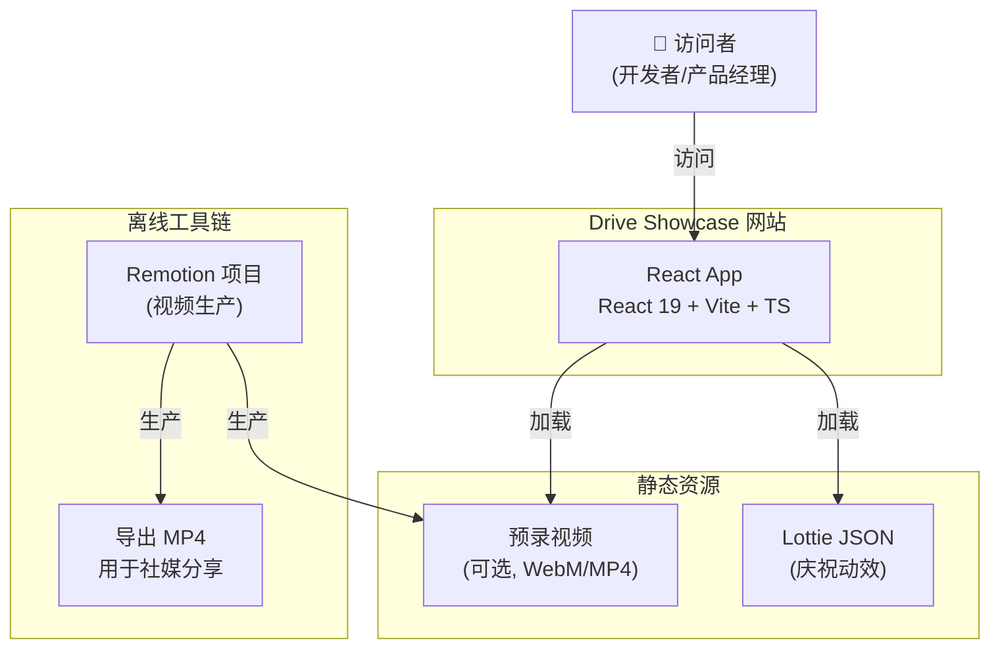
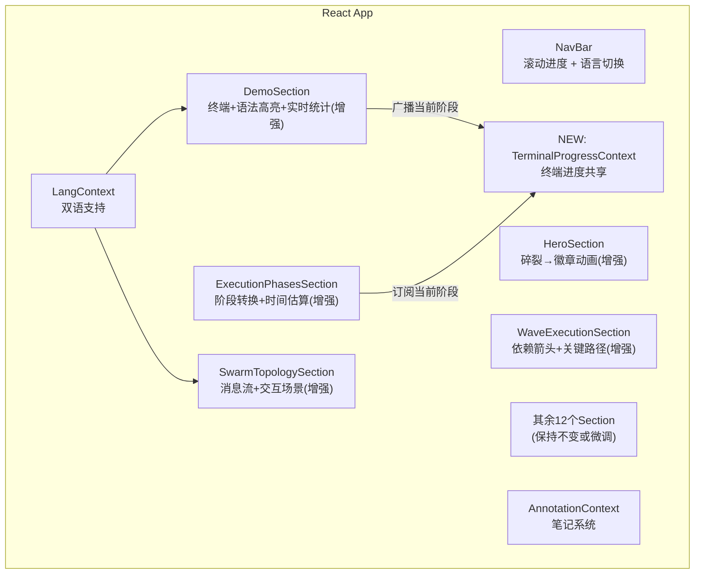
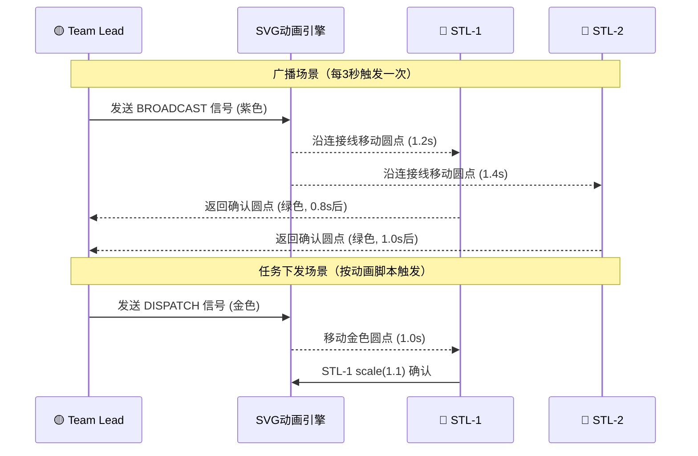

# Drive Showcase: 视觉增强架构设计

> **Status**: Archived — partially implemented (message flow animation done in v0.5.0). Remaining items (video, particle effects) deferred indefinitely.
> 文档版本: 1.0
> 生成时间: 2026-03-01
> 范围: 视频/动效升级方案架构设计

---

## Executive Summary

Drive Showcase 是一个用于展示 Claude Code Drive Skill 的 React 交互式展示网站，已具备扎实的 Framer Motion 动效基础（9/10 动效质量）。

核心问题：**如何从"好的可视化大纲"升级为"令人信服的直觉性演示"？**

**结论：无需 Remotion，也无需引入视频文件。** 通过三层渐进式增强策略（Path A+B 混合），可以在 0-1 个新依赖的情况下将视觉冲击力提升至行业顶尖水平。Remotion 作为独立工具链用于生成可分享的 MP4 视频资产，不集成进主应用。

---

## 1. 系统现状诊断

```
当前技术栈：
  React 19.2 + TypeScript
  Vite 7.3.1
  Tailwind CSS 4.2.1
  Framer Motion 12.34.3  ← 已有强大动效基础

已有动效能力：
  ✅ Viewport 触发动画 (whileInView)
  ✅ 交错子动画 (staggerChildren)
  ✅ SVG 节点/连接线动画
  ✅ 打字机终端动画
  ✅ 物理弹簧动画
  ✅ 粒子碎裂效果 (Hero)

当前短板：
  ❌ 终端输出无语法高亮 → 开发者无法快速扫描
  ❌ 集群拓扑是静态的 → 没有展示"动态编排"的本质
  ❌ 节点间消息流动不可见 → 通信这一核心概念无法感知
  ❌ 波次执行无依赖关系箭头 → 关键路径概念抽象
  ❌ 阶段洞察卡片是静态的 → 与终端动画脱节
```

---

## 2. 设计空间全景

### 2.1 四条主路径

| | Path A | Path B | Path C | Path D |
|--|--------|--------|--------|--------|
| **名称** | 纯动效增强 | 动效栈升级 | Remotion 视频化 | 真实录屏嵌入 |
| **新依赖** | 0 | +2-3 (~70KB) | +remotion (~600KB) | 0 |
| **工作量** | M | L | XL | M |
| **交互性** | 完整保留 | 完整保留 | 丧失 | 部分丧失 |
| **可维护性** | 高 | 中-高 | 中 | 低（视频易过期）|
| **视觉质量上限** | 9.5/10 | 9.8/10 | 10/10 | 10/10（真实感）|
| **首屏加载影响** | 0 | +0.1s | +0.3-0.8s | +0.5-2s |

### 2.2 模块 × 方案矩阵

| 模块 | Path A | Path B | Path C | Path D |
|------|--------|--------|--------|--------|
| 终端执行动画 | 语法高亮+实时统计 | +GSAP精确时间线 | Remotion合成替换 | 录屏视频替换 |
| 集群拓扑图 | 消息流动+交互场景 | +React Spring物理弹性 | D3力导布局 | 录屏 |
| 波次执行甘特图 | 依赖箭头+关键路径hover | +GSAP关键路径动画 | 程序化甘特视频 | 录屏 |
| Hero首屏 | 碎裂→徽章语义化 | +Matter.js粒子 | Remotion开场视频 | 保持不变 |
| 阶段执行流 | 阶段转换箭头+时间估算 | +Lottie庆祝效果 | Remotion序列合成 | 保持不变 |

---

## 3. 优化目标规格

```
OPTIMIZATION GOALS
==================
PRIMARY:    访问者 30 秒内直觉感受到 "并行编排 vs 串行" 的量级差异
            → 测量: 用户研究"你理解了什么"开放题

SECONDARY:  首屏 LCP < 2.5s (Core Web Vitals)
            动效帧率 ≥ 55fps (Chrome DevTools Performance)
            Lighthouse Performance ≥ 90

CONSTRAINTS:
  - 保持 React/Vite/TypeScript 主技术栈
  - 不破坏现有 18 个 section 结构
  - 不引入超过 100KB (gzip) 的单一依赖
  - 双语支持 (EN/ZH) 需保留

ANTI-GOALS:
  - 不追求网页视频的播放控制（这是展示站不是视频平台）
  - 不为全部 section 都加动效（避免过度动效）
  - 不用 Remotion 替换交互式动画（会失去实时响应性）
```

---

## 4. 路径对比与消除

### 4.1 消除轮

**Path C: Remotion 视频化 — 不适合主应用集成**

最强理由：
> Remotion 设计用于预渲染视频。你的展示站的核心价值是"可交互的实时可视化"。将 Remotion player 嵌入网页，用户看到的是一个不能暂停就快进、不能hover就探索的视频框——这正好是你现有交互动效的降级。

致命场景：
> 有人在手机上查看 → 600KB+ 的 player bundle 加载 3 秒，最终看到一个16:9 视频盒，远不如当前的响应式动效。

**结论：Remotion 应用于 独立视频资产生产（用于 Twitter/YouTube 分享），不集成进主网站。**

**Path D: 真实录屏嵌入 — 仅适合少数关键位置**

最强理由：
> Drive Skill 执行一次完整任务需要 60-130 分钟。你不可能录制完整的真实执行视频嵌入网页。你能录制的只有 1-3 分钟的片段——而这些片段会比现有动效更抽象，不是更直观。

致命场景：
> Drive Skill 功能迭代 → 录屏视频立即过期。维护成本极高。

**结论：录屏视频可用于"真实案例展示"独立板块（可选），不替换核心动效。**

### 4.2 胜出：Path A + Path B 精选合并

| 层级 | 策略 | 实现方式 |
|------|------|----------|
| Layer 1: 语义增强 | 让现有内容更易读 | 终端语法高亮、节点角色颜色、阶段标记 |
| Layer 2: 流动可见 | 让通信/执行流动起来 | SVG motionPath 消息流、依赖箭头、波前指示器 |
| Layer 3: 交互深度 | 奖励好奇心 | 节点 hover 详情、场景切换、时间线 scrubber |

---

## 5. 详细设计：三层增强方案

### 5.1 终端执行区 (DemoSection)

**问题：** 当前终端是颜色文字流，缺乏结构感知。

**解决方案：语义结构层**

```tsx
// 当前实现（简化）
const lines = [
  { text: '$ /drive "Build auth feature"', type: 'input' },
  { text: '  Phase 0: Deep Briefing...', type: 'phase' },
]

// 增强实现：结构化行解析
interface TerminalLine {
  type: LineType;
  segments: Segment[];  // 支持行内多色段
  annotation?: string;  // 行旁注释
}

type Segment =
  | { kind: 'command';  text: string }  // 青色 monospace
  | { kind: 'agent';    text: string }  // 金色
  | { kind: 'number';   text: string }  // 品红色，数字醒目
  | { kind: 'phase';    text: string }  // 对应阶段颜色
  | { kind: 'success';  text: string }  // 绿色 + 微脉冲
  | { kind: 'path';     text: string }  // 暗青色
```

**实时统计面板（浮动在终端右侧）：**

```
┌─────────────────────┐
│  LIVE METRICS       │
│  ─────────────────  │
│  Agents: 5          │  ← 随终端行数变化
│  Tasks : 8/15       │
│  Time  : 3:24       │  ← 实时计时器
│  Phase : Wave 2     │  ← 当前阶段
└─────────────────────┘
```

**与洞察卡联动：**
```
当终端进入 Phase 1 → 对应洞察卡边框 shimmer + scale(1.01)
当终端到达 Wave 2 → 对应洞察卡图标变为 LIVE 指示器
```

**数据流向：**
```
useTerminalProgress()
    → 当前行索引
    → 当前阶段ID
    → 广播到 PhaseInsightCards (通过 context 或 prop drilling)
```

---

### 5.2 集群拓扑区 (SwarmTopologySection)

**问题：** 静态图展示了架构，但没有展示最重要的"动态编排"行为。

**解决方案：三阶段演化动画 + 消息流可见化**

#### 消息流动设计

```
广播消息流向：
  Team Lead → (pulse wave) → 所有 STL → (cascade) → 内部 agent

消息可视化：
  1. 从发送节点产生 motion.circle (半径 6px, 颜色对应消息类型)
  2. 沿 SVG 连接线路径移动 (motionPath + 缓动)
  3. 到达接收节点后爆开 + 消失
  4. 接收节点短暂 scale(1.1) 确认

消息类型颜色：
  DISPATCH  → #f59e0b (金色) - 任务下发
  RETURN    → #10b981 (绿色) - 结果返回
  BROADCAST → #a78bfa (紫色) - 全局广播
  ERROR     → #ef4444 (红色) - 错误信号
```

#### 交互场景切换（3个按钮）

```
[正常运行] [扩展场景] [错误恢复]

正常运行（默认）：
  → 当前静态图 + 消息流动

扩展场景（点击触发）：
  → 动画：新 STL 节点从 Team Lead 扩展出来
  → 3个内部 agent 从新 STL 展开
  → 连接线渐入
  → 配文: "Mission scope expanded → spawning STL-3 with 3 inner agents"

错误恢复（点击触发）：
  → 某个 agent 节点变红 + 闪烁
  → 其他 agent 向 Team Lead 发送消息
  → Team Lead 向新 agent 节点发送 DISPATCH
  → 红色节点淡出，新节点淡入
  → 配文: "Agent failure detected → auto-recovery in 2s"
```

#### 节点详情 Hover

```
hover 任何节点时显示：
┌───────────────────────────────┐
│ 🤖 STL-1 (Sub Team Lead)     │
│ ─────────────────────────     │
│ Current tasks: 3              │
│ Managed agents: 2             │
│ Status: ● Active              │
│ Last action: Dispatched tests │
└───────────────────────────────┘
```

---

### 5.3 波次执行区 (WaveExecutionSection)

**问题：** 甘特图展示了分解结果，但没有展示"依赖关系"和"为什么这样分组"。

**解决方案：依赖关系可见 + 关键路径交互**

#### 任务依赖箭头

```
在波次之间绘制 SVG 箭头：
  Bootstrap (Wave 0) → Core Implementation (Wave 1)  [关键依赖]
  Bootstrap (Wave 0) → Integration (Wave 2)          [间接依赖]
  Core Implementation (Wave 1) → Hardening (Wave 3)  [关键路径]

箭头样式：
  关键路径: 红色虚线, strokeWidth=2, 带箭头marker
  普通依赖: 灰色虚线, strokeWidth=1
  已完成:   绿色实线 (动画从虚→实)
```

#### 关键路径 Hover 交互

```
hover 任意任务条时：
  1. 高亮该任务在关键路径上的所有前后置任务
  2. 其他任务半透明 (opacity: 0.3)
  3. 显示 tooltip：
     "If this task takes 2x → total time +4h (+33%)"
  4. 关键路径任务的 tooltip 额外显示：
     "⚠️ Critical path — no slack time"
```

#### 波次执行进度动画优化

```
当前: 任务条直接出现
优化: 任务条从左到右"绘制"出来

animation sequence for each wave:
  0ms: 波次标题淡入
  200ms: 任务条一起开始从左绘制 (width: 0% → X%)
  任务条宽度表示相对耗时
  同波次所有任务并行绘制 (表示并行执行)
  不同波次之间有 400ms 间隔 (表示波次切换)
```

---

### 5.4 Hero首屏增强

**问题：** 碎裂动画视觉冲击力强，但与内容语义脱节。

**解决方案：碎裂 → 重组为徽章**

```
当前流程：
  打字机 → 碎裂(红色碎片) → 重组(金色文字)

优化流程：
  打字机 → 碎裂(碎片飞散) → 碎片归位为5个徽章 → 金色文字出现

每个碎片组对应一个能力徽章：
  🐝 碎片组 → SWARM INTELLIGENCE 徽章位置
  🌊 碎片组 → WAVE EXECUTION 徽章位置
  📐 碎片组 → STRUCTURED DISCIPLINE 徽章位置
  📡 碎片组 → ASYNC COMMUNICATION 徽章位置
  🏛️碎片组 → PANTHEON WISDOM 徽章位置

这样：
  - 碎裂动画有了语义（旧的思维框架碎裂）
  - 重组有了叙事（新的能力涌现）
  - 徽章的初次出现更有张力
```

---

### 5.5 Remotion 作为独立工具链

**核心结论：Remotion 不集成进网站，作为视频内容生产工具**

```
独立 Remotion 工作目录（建议）：
  erwin/
  ├── drive-showcase/        ← 网站（不含 Remotion）
  └── drive-videos/          ← NEW: Remotion 视频项目
      ├── src/
      │   ├── compositions/
      │   │   ├── AgentExecution.tsx     ← Drive 执行全流程
      │   │   ├── SwarmTopology.tsx      ← 集群拓扑演示
      │   │   └── WaveExecution.tsx      ← 波次执行演示
      │   └── Root.tsx
      ├── remotion.config.ts
      └── package.json

生产的视频用于：
  - Twitter/X 分享 (30s 精华版)
  - YouTube 详细教程 (5-10min)
  - LinkedIn 产品演示
  - Slack/邮件中的 GIF 演示
  - 网站中的可选"完整演示"区块（<video autoplay muted loop>）
```

**网站中嵌入预录视频（可选，Path D 精华）：**

```tsx
// 一个新的 FullDemoSection（可选添加）
// 使用 <video> 标签，不用任何 JS 库
export function FullDemoSection() {
  return (
    <section>
      <h2>Watch it Run</h2>
      <video
        autoPlay
        muted
        loop
        playsInline
        preload="none"           // 懒加载
        poster="/demo-poster.jpg"  // 加载占位图
      >
        <source src="/demo.webm" type="video/webm" />
        <source src="/demo.mp4" type="video/mp4" />
      </video>
    </section>
  )
}
// 无需任何新依赖，原生 HTML5
```

---

## 6. 架构图

### 6.1 系统上下文图 (C4 Level 1)



### 6.2 组件容器图 (C4 Level 2)



### 6.3 关键流程：消息流动时序



---

## 7. 关键决策日志

| 决策 | 选择 | 拒绝的方案 | 原因 |
|------|------|------------|------|
| Remotion 集成方式 | 独立工具链 | 集成进网站 | 主应用引入 600KB+，失去实时交互性 |
| 视频嵌入策略 | 原生 `<video>` (可选) | `@remotion/player` | 零依赖，更好的性能控制 |
| 新动效库 | 不引入 (或仅 Lottie) | React Spring / GSAP | Framer Motion 已足够；Lottie 仅用于庆祝效果 |
| 集群拓扑交互 | 场景切换按钮 | 完全自由拖拽 | 自由拖拽会干扰内容阅读；预设场景更好讲故事 |
| 关键路径可视化 | hover 高亮 | 常驻显示 | 常驻显示会干扰基础阅读，hover 是渐进式揭示 |
| 终端统计面板 | 浮动在终端内 | 独立侧边栏 | 保持 section 布局不变；不破坏现有结构 |

---

## 8. 风险登记

| 风险 | 可能性 | 影响 | 缓解措施 |
|------|--------|------|----------|
| 消息流动动画性能下降 | 中 | 高 | 限制同屏最多 5 个动画圆点；超出复用对象池 |
| 交互场景切换导致布局闪烁 | 低 | 中 | 用 AnimatePresence + layout prop 平滑过渡 |
| 视频文件太大影响加载 | 高 | 高 | `preload="none"` + poster + IntersectionObserver 懒加载 |
| Remotion 项目独立维护负担 | 中 | 低 | 网站不依赖 Remotion；视频是可选增强 |
| 过度动效分散注意力 | 中 | 中 | 所有自动循环动效必须 `prefers-reduced-motion` 兼容 |

---

## 9. 实施路线图

### Phase 1: 快速胜利（1-2天）
**目标：** 让现有内容更易读、更有层次感

```
□ DemoSection: 终端行语法高亮（segment 化）
□ DemoSection: 平滑滚动替换跳跃滚动
□ DemoSection: 阶段洞察卡与终端联动（active state）
□ SwarmTopologySection: 节点 hover 详情 tooltip
□ SwarmTopologySection: 节点脉冲速度按角色分层
□ 全局: 添加 prefers-reduced-motion 支持
```

预期效果：终端可读性从 6/10 → 9/10

### Phase 2: 流动可见（3-5天）
**目标：** 让通信和执行流动起来，使核心概念可感知

```
□ SwarmTopologySection: SVG 消息流动圆点动画
  - 实现 motionPath 沿连接线移动
  - 4种消息颜色（dispatch/return/broadcast/error）
  - 接收节点确认动画
□ WaveExecutionSection: 任务依赖箭头
  - 波次间 SVG 连接线
  - 关键路径高亮颜色
□ WaveExecutionSection: 任务条从左到右绘制动画
□ DemoSection: 实时指标浮动面板（agents/tasks/time/phase）
```

预期效果：集群通信从"看不见"→"直觉可感"

### Phase 3: 交互深度（5-8天）
**目标：** 奖励开发者好奇心，提供"自己探索"的满足感

```
□ SwarmTopologySection: 3个交互场景（正常/扩展/恢复）
□ WaveExecutionSection: hover 显示关键路径影响
□ DemoSection: 时间线进度条/scrubber
□ ExecutionPhasesSection: 阶段转换 SVG 箭头（滚动驱动）
□ HeroSection: 碎裂→徽章语义动画（重要但工作量大）
```

预期效果：停留时间从平均 45s → 90s+

### Phase 4: 视频资产生产（可选，独立进行）
**目标：** 生产可分享的视频内容用于社交媒体

```
□ 初始化独立 drive-videos/ Remotion 项目
□ 实现 AgentExecution.tsx 合成（展示完整执行流程，30s版）
□ 实现 SwarmTopology.tsx 合成（集群扩展可视化，15s版）
□ 导出 MP4 + WebM + GIF 格式
□ 可选：网站中添加 FullDemoSection（原生 video 标签）
```

---

## 10. 附录：被拒绝方案详情

### Remotion 集成进主网站

**最强支持论点：**
> 用代码生成专业级视频是 2026 年的技术前沿，展示这种能力本身就是对 Drive Skill 实力的背书。`@remotion/player` 可以提供交互控制，用户可以暂停、快进。

**反驳：**
> 你的 Swarm 可视化是响应式的——Remotion player 是固定比例的视频盒，在手机/竖屏上糟糕。你的终端动画会响应用户滚动——Remotion 不能。600KB 的 player bundle 对首屏加载是真实伤害。最重要的：你现有的 Framer Motion 动效已经是"程序化视觉叙事"，这正是 Remotion 的价值所在——你已经有了，不需要用视频框架重新实现。

### React Spring 集成

**最强支持论点：**
> 物理弹簧动画对节点弹跳效果更自然，Framer Motion 的弹簧配置不如 React Spring 直观。

**反驳：**
> Framer Motion 12 的 `type: "spring"` 已经足够好。引入第二个动效库带来双重 API 认知负担，对未来维护者是陷阱。`tension: 300, friction: 20` 的效果与 Framer Motion `stiffness: 300, damping: 20` 等效。为了边际改善引入 30KB 依赖不值得。

### D3.js 力导向图

**最强支持论点：**
> 真正的力导向布局能表现涌现性——节点自然找到平衡位置，动态更美。

**反驳：**
> Drive Skill 的拓扑结构是确定性的层级结构，不是自由网络。力导向会让层级关系变模糊。D3 和 React 的 DOM 管理哲学冲突（命令式 vs 声明式），会引入大量 useEffect 管理。你当前的 SVG + Framer Motion 方案更适合展示确定性层级。

---

## 结语

**最简洁的系统是能完成使命的最小系统。**

Drive Showcase 已经是 8.5/10 的高质量展示站。这份架构文档的核心建议是：**不要引入大型新框架，而是让现有系统的潜力充分释放。**

消息流动动画、语法高亮、关键路径交互——这些增强不依赖新框架，但会将用户对"Drive Skill 并行编排"的理解从抽象概念变为直觉感受。

Remotion 是好工具，但属于内容生产工具链，不是网站依赖。

> Simplicity is the ultimate sophistication. — Leonardo da Vinci
