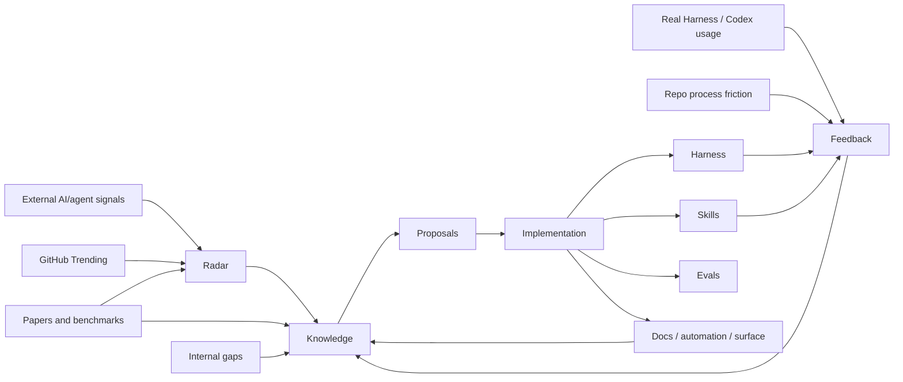

# erwin Operating Model

> Status: Active
>
> Date: 2026-04-17
>
> Purpose: define the repo-level knowledge-to-action loop for `erwin` so Radar, Feedback, Knowledge, Proposals, and Implementation sessions share one operating map.

---

## Project Identity

`erwin` is an AI/agent frontier exploration lab.

It is no longer centered on showcase work or a narrow skill incubator story. The repo now exists to observe frontier AI/agent movement, turn real usage pressure into durable understanding, and evolve concrete agent-system capabilities without letting fresh signal bypass review.

The core system is a five-layer loop:

`Radar + Feedback -> Knowledge -> Proposals -> Implementation -> Feedback / Knowledge`

## Five-Layer Model

| Layer | Responsibility | Canonical Entry |
|---|---|---|
| `Radar` | Collect authoritative AI/agent external signal, including daily radar, weekly synthesis, GitHub Trending, and selective paper watch. | [`docs/radar/README.md`](radar/README.md) |
| `Feedback` | Capture real Harness, Codex, and repo-process friction as normalized usage evidence instead of scattered session memory. | [`docs/feedback/README.md`](feedback/README.md) |
| `Knowledge` | Weave radar, feedback, papers, benchmarks, and internal gaps into durable understanding and active threads. | [`docs/knowledge/README.md`](knowledge/README.md) |
| `Proposals` | Hold reviewed change candidates only after upstream knowledge has enough evidence density. | [`docs/proposals/README.md`](proposals/README.md) |
| `Implementation` | Change Harness, Skills, evals, docs, automation, or the knowledge surface from reviewed proposals or explicit internal gaps. | repo code, `skills/`, `harness/`, `scripts/`, `cmd/`, `internal/` |

`Harness` is not a separate knowledge layer. It is the main implementation target and one of the strongest feedback sources.

`Skills` are not the repo center. They are reusable implementation and operating capabilities that support the current agent-systems direction.

`Knowledge Surface` is the reading and navigation layer for this loop. It should make the system visible, but it does not replace Markdown truth, active threads, or proposal review.

`Automations` are intake and refresh mechanisms. They write radar and surface data; they are not themselves the repo's reasoning layer.

## Machine-Readable Knowledge Network

The five-layer model also has a generated machine-readable snapshot:

- [`docs/knowledge/index.json`](knowledge/index.json)
  - `knowledge_network.artifacts`: repo-owned nodes for Radar, Feedback, Knowledge, Proposals, and selected Implementation entrypoints
  - `knowledge_network.links`: typed local Markdown references between those artifacts
  - `knowledge_network.threads`: parsed active knowledge threads from [`docs/knowledge/active-threads.md`](knowledge/active-threads.md), including evidence classes, linked proposals, and anchor artifacts
  - `knowledge_network.proposal_records`: parsed proposal-ledger rows from [`docs/proposals/harness-proposal-ledger.md`](proposals/harness-proposal-ledger.md)

This index is a navigation and handoff contract, not a database.
Markdown remains the source of truth, and the index must be regenerated from repo files instead of edited by hand.

When a session changes Radar notes, Feedback cases, active Knowledge threads, proposal ledgers, or implementation entrypoints that serve as canonical anchors, it should refresh the generated surface with:

```bash
python3 scripts/build-knowledge-surface.py
```

## System Flow



## Layer Boundaries

### Radar

Radar may:

- collect high-signal first-party AI/agent updates
- keep durable daily, weekly, trending, and paper-watch notes
- name themes and watch-next pressure
- refresh generated knowledge surfaces after stream updates

Radar must not:

- directly mutate `Harness` runtime
- turn every daily or weekly note into a proposal
- let tooling-watch noise outrank first-party signal

### Feedback

Feedback may:

- capture repeated real-usage friction
- normalize Harness, Codex, worktree, automation, and repo-process failure modes
- preserve success patterns worth keeping

Feedback must not:

- become a raw session dump
- preserve low-value thread narrative as if it were durable knowledge
- skip the knowledge layer when proposing system changes

### Knowledge

Knowledge may:

- maintain active threads
- reconcile radar signal, feedback cases, papers, benchmarks, and internal gaps
- create durable synthesis, comparisons, timelines, and concept maps
- decide when proposal pressure is justified

Knowledge must not:

- become a research pile
- create proposals from novelty alone
- use session memory as a substitute for file-backed understanding

### Proposals

Proposals may:

- hold reviewed change candidates
- classify dispositions such as `watch`, `encode-as-eval`, `prototype`, and `adopt`
- connect implementation work back to durable upstream anchors

Proposals must not:

- mechanically mirror daily or weekly radar
- accept unanchored fresh signal as implementation permission
- hide evidence gaps behind confident roadmap language

### Implementation

Implementation may:

- change Harness runtime, Skills, evals, docs, automations, and knowledge-surface code
- fix clear bugs and already-decided internal gaps
- consume reviewed proposals and update verification gates

Implementation must not:

- bypass proposal gates for strategic changes
- treat external vendor claims as local maturity proof
- finish without updating `CURRENT`, `CHANGELOG`, and any affected knowledge or feedback surfaces

## Cross-Cutting Surfaces

| Surface | Role in the five-layer system |
|---|---|
| `Harness` | Main implementation target, stable first line, and strongest real-usage feedback source. |
| `Skills` | Reusable capability layer that supports Harness, Knowledge, Radar, and repo operation. |
| `Automations` | Scheduled intake and refresh machinery for radar notes and generated surfaces. |
| `Knowledge Surface` | Human-facing reading and navigation layer over repo-owned Markdown and generated indexes. |
| `Research` | Bounded investigation archive; useful context, not active truth by default. |
| `_project/CURRENT.md` | Live operational handoff; should point at current work, not preserve stale next-step guesses. |

## Session Routing

### Radar Session

Start with:

- [`docs/radar/README.md`](radar/README.md)
- [`docs/radar/sources.md`](radar/sources.md)
- [`docs/radar/themes.md`](radar/themes.md)
- relevant `daily/`, `weekly/`, `trending/`, or `papers/` stream README

Expected output:

- dated notes
- `latest.md` refreshes
- weekly synthesis when scheduled
- knowledge surface refresh

Do not emit runtime changes directly.

### Feedback Session

Start with:

- [`docs/feedback/README.md`](feedback/README.md)
- [`docs/feedback/harness-usage-case-template.md`](feedback/harness-usage-case-template.md)
- relevant Harness or Codex usage evidence

Expected output:

- normalized usage cases
- concrete friction or success patterns
- links back to active knowledge threads when the case changes what the repo knows

Do not dump raw sessions as knowledge.

### Knowledge Session

Start with:

- [`docs/knowledge/README.md`](knowledge/README.md)
- [`docs/knowledge/operating-model.md`](knowledge/operating-model.md)
- [`docs/knowledge/active-threads.md`](knowledge/active-threads.md)
- relevant radar, feedback, paper, benchmark, or proposal anchors

Expected output:

- active-thread updates
- durable synthesis notes
- proposal pressure only when evidence is mature

Do not mutate Harness runtime directly.

### Proposal Session

Start with:

- [`docs/proposals/README.md`](proposals/README.md)
- relevant active knowledge thread
- relevant feedback case, weekly synthesis, or paper-watch anchor

Expected output:

- reviewed change candidate
- disposition
- evidence trail
- smallest justified next move

Do not create proposals from every new signal.

### Implementation Session

Start with:

- `AGENTS.md`
- [`_project/CURRENT.md`](../_project/CURRENT.md)
- this file
- the specific docs for the target layer, such as [`docs/harness-documentation-map.md`](harness-documentation-map.md) for Harness or [`docs/knowledge/README.md`](knowledge/README.md) for the knowledge surface

Expected output:

- code, docs, automation, skill, or eval changes
- targeted verification
- `_project/CURRENT.md` and `CHANGELOG.md` updates
- feedback or knowledge updates when real usage changes what the repo now knows

Do not let a fresh radar signal become implementation work without a reviewed proposal or explicit bug/internal-gap rationale.

## Promotion Rules

| From | To | Promotion condition |
|---|---|---|
| Fresh external signal | `Radar` | Source is authoritative or strategically useful supporting evidence. |
| Repeated usage friction | `Feedback` | The pattern is durable enough to outlive one session. |
| Radar / feedback / paper / internal gap | `Knowledge` | There is a stable interpretation worth carrying forward. |
| Knowledge thread | `Proposals` | Evidence density is high enough to justify a bounded candidate. |
| Proposal | `Implementation` | Disposition is reviewed as `encode-as-eval`, `prototype`, or `adopt`. |
| Implementation result | `Feedback` / `Knowledge` | The change reveals new usage pressure, resolves a thread, or changes future interpretation. |

Bugfixes and already-decided internal gaps can go directly to implementation, but the session must still explain the evidence and update the relevant handoff docs.

## Staleness Rules

When repo artifacts disagree:

- trust machine-readable runtime or manifest truth for package and runtime shape
- trust reviewed proposal artifacts for change-candidate disposition
- trust active knowledge threads for durable interpretation
- trust `_project/CURRENT.md` for live handoff only when it is fresh and not contradicted by more specific durable artifacts
- treat old session logs and research notes as supporting context, not final truth

When a session finds stale guidance:

- update the entrypoint that misled the session
- do not leave the correction only in chat
- prefer small routing fixes over duplicating whole operating models

## Multi-Session Handoff

At the end of a meaningful session, record:

- which layer changed
- whether the work created new feedback evidence
- whether an active knowledge thread changed
- whether proposal pressure increased, decreased, or stayed unchanged
- whether implementation changed runtime, skills, evals, docs, automation, or the knowledge surface
- which verification gate was run

This keeps future sessions from reconstructing the repo from thread memory.
