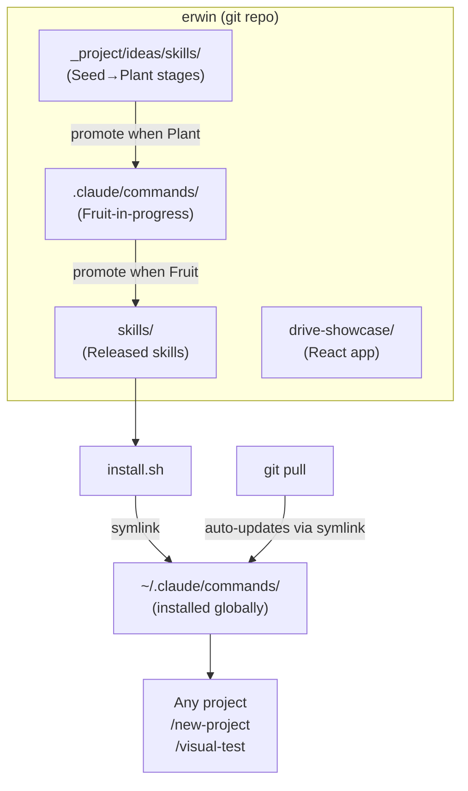

# erwin — Skills Incubator Architecture

**Status**: Proposed — ADR-0007 (pending)
**Date**: 2026-03-02
**Replaces**: Informal skills placement (skills written directly to ~/.claude/commands/)

---

## Executive Summary

erwin has dual identity: (1) a React showcase explaining drive-skill, and (2) a skills factory producing new Claude Code commands. Currently the factory side is invisible — `new-project.md` and `visual-test.md` live in `~/.claude/commands/` with no version control, no update mechanism, and no documentation. This architecture formalizes erwin as a skills incubator: skills live in the git repo, are symlink-installed globally, and follow a clear idea-to-release pipeline.

---

## System Diagram

```
IDEA PIPELINE (top to bottom = increasing maturity)

INBOX.md (raw ideas)
  │
  ▼
_project/ideas/skills/ (Seed → Sprout → Plant stages)
  │  • skill design docs
  │  • stage: Seed 🌱 / Sprout 🌿 / Plant 🌱
  │
  ▼  (when Plant: spec complete, ADR written)
.claude/commands/ (Fruit-in-progress: project-level incubation)
  │  • skill under active development / testing
  │  • available only inside erwin project
  │
  ▼  (when Fruit 🍎: working, tested, documented)
skills/{name}/ (RELEASED)
  │  • new-project/, visual-test/, ...
  │  • each has: skill.md + README.md + CHANGELOG.md
  │
  ▼  (after ./install.sh)
~/.claude/commands/{name}.md (INSTALLED)
     • symlink back to skills/{name}/{name}.md
     • git pull → instant update, no reinstall
     • available in ANY project, not just erwin
```

---

## Key Decisions

### Decision 1: Skills live in `skills/` dir in erwin repo
**Chosen**: `skills/{name}/{name}.md` → symlinked to `~/.claude/commands/`
**Rejected**: Separate repos per skill (too much overhead for .md files)
**Rejected**: Skills only as project-level commands (not globally available)
**Rationale**: Mirrors the proven drive-skill pattern exactly. Version-controlled, updatable via `git pull`, globally installable.

### Decision 2: Two-stage incubation (project-level → global)
**Chosen**: `.claude/commands/` for WIP skills, `skills/` for released
**Rationale**: Lets a skill be tested in erwin context before being globally promoted. Clear gate: Plant stage → project-level; Fruit stage → global skills/.

### Decision 3: Per-skill CHANGELOG + project aggregate
**Chosen**: Each skill has its own `CHANGELOG.md`; project `CHANGELOG.md` aggregates
**Rationale**: When `new-project` has a breaking change, users need to know the version. Skill-specific changelogs enable independent versioning.

### Decision 4: install.sh symlink-based (not copy)
**Chosen**: `ln -sf skills/{name}/{name}.md ~/.claude/commands/`
**Rationale**: `git pull` immediately reflects in installed skills. No manual reinstall step. Reversible — remove symlinks to uninstall.

---

## Directory Structure (proposed)

```
erwin/
├── CLAUDE.md              ← Add: Skills section, install.sh reference
├── CHANGELOG.md           ← Add: Skills section aggregating releases
├── install.sh             ← NEW: symlinks skills → ~/.claude/commands/
│
├── skills/                ← NEW: source of truth for all erwin skills
│   ├── README.md          ← Skill index + contribution guide
│   ├── new-project/
│   │   ├── new-project.md     ← THE SKILL (moved from ~/.claude/commands/)
│   │   ├── README.md          ← Usage, examples, requirements
│   │   └── CHANGELOG.md       ← Skill version history
│   └── visual-test/
│       ├── visual-test.md     ← THE SKILL (moved from ~/.claude/commands/)
│       ├── README.md          ← Usage, examples, requirements
│       └── CHANGELOG.md       ← Skill version history
│
├── .claude/
│   ├── commands/          ← NEW: project-level incubation stage
│   │   └── (skills under development, tested in erwin only)
│   ├── rules/             ← Unchanged
│   └── drive/             ← Unchanged
│
├── _project/
│   ├── GOALS.md           ← Update OKR O2 to reflect incubator mission
│   ├── CURRENT.md         ← Update priorities
│   ├── ROADMAP.md         ← Add Milestone: Skills v1.0 (2 skills released)
│   ├── ideas/
│   │   ├── INBOX.md       ← Unchanged
│   │   ├── skills/        ← POPULATE: move visual-test-skill.md here
│   │   │   └── visual-test-skill.md   ← MOVED from ideas/ root
│   │   └── meta/          ← Unchanged
│   └── decisions/
│       └── 0007-skills-incubator-structure.md  ← NEW ADR
│
├── drive-showcase/        ← Unchanged
├── docs/                  ← Add this document
└── reference/             ← Unchanged
```

---

## install.sh Design

```bash
#!/usr/bin/env bash
# erwin skills installer
# Symlinks erwin skills to ~/.claude/commands/ for global availability
#
# Usage:
#   ./install.sh           # install all skills
#   ./install.sh new-project    # install one skill

set -euo pipefail

SCRIPT_DIR="$(cd "$(dirname "${BASH_SOURCE[0]}")" && pwd)"
SKILLS_DIR="$SCRIPT_DIR/skills"
TARGET_DIR="$HOME/.claude/commands"

mkdir -p "$TARGET_DIR"

install_skill() {
  local name="$1"
  local src="$SKILLS_DIR/$name/$name.md"
  local dst="$TARGET_DIR/$name.md"

  if [[ ! -f "$src" ]]; then
    echo "⚠️  Skill not found: $src"
    return 1
  fi

  # Backup if exists and is not already a symlink to us
  if [[ -f "$dst" && ! -L "$dst" ]]; then
    mv "$dst" "$dst.bak"
    echo "   Backed up existing $dst → $dst.bak"
  fi

  ln -sf "$src" "$dst"
  echo "✅ /$name → $src"
}

if [[ $# -eq 0 ]]; then
  echo "🚀 Installing all erwin skills..."
  for dir in "$SKILLS_DIR"/*/; do
    install_skill "$(basename "$dir")"
  done
  echo ""
  echo "Done. Skills installed to $TARGET_DIR"
  echo "Update: git pull && (symlinks auto-update)"
elif [[ -d "$SKILLS_DIR/$1" ]]; then
  install_skill "$1"
else
  echo "Unknown skill: $1"
  echo "Available: $(ls "$SKILLS_DIR" | tr '\n' ' ')"
  exit 1
fi
```

---

## Version Management

### Per-Skill Versioning

Each `skills/{name}/CHANGELOG.md`:
```markdown
# {skill-name} Changelog

## [Unreleased]

## [1.0.0] — 2026-03-02
### Added
- Initial release
- [key features]
```

Skills follow semantic versioning:
- **MAJOR**: Breaking changes to skill behavior or required arguments
- **MINOR**: New variants, new capabilities, backward-compatible
- **PATCH**: Fixes, clarifications, documentation

### Project-Level Aggregation

`CHANGELOG.md` gets a **Skills** subsection:
```markdown
## [0.6.0] — 2026-03-02
### Skills
- new: /new-project v1.0.0 — bootstrap any project with AI intelligence layer
- new: /visual-test v1.0.0 — visual bug detection via Playwright screenshots
```

---

## Skill Idea Pipeline

The `_project/ideas/skills/` directory is the upstream source for all skills in `skills/`. The flow:

| Stage | Location | Criteria to advance |
|-------|----------|-------------------|
| Seed 🌱 | `ideas/INBOX.md` | Raw idea captured |
| Sprout 🌿 | `ideas/skills/{idea}.md` | Problem clear, approach explored |
| Plant 🌱 | `ideas/skills/{idea}.md` | Spec complete, ADR written |
| Fruit 🍎 | `skills/{name}/` | Working, tested, documented, installable |

Skills that reach Fruit stage are also moved from `.claude/commands/` (incubation) to `skills/` (released).

---

## What Self-Learning Looks Like (Already Implemented)

erwin already has full self-learning infrastructure:

1. **Session logs** (`_project/sessions/YYYY-MM-DD.md`) — every AI session recorded
2. **Auto-memory** (`~/.claude/projects/{hash}/memory/MEMORY.md`) — persistent cross-session context
3. **CURRENT.md** — living status, read at session start
4. **GOALS.md + ROADMAP.md** — north star prevents drift

The `/new-project` skill propagates this infrastructure to any new project. This IS the self-learning system — no additional infra needed.

Optional enhancement (not in MVP): PostToolUse hook that auto-captures session summaries. Deferred to a separate mission.

---

## Implementation Roadmap

### Phase 1 (MVP — this session, ~1 hour)
1. Create `skills/new-project/` with new-project.md + README.md + CHANGELOG.md
2. Create `skills/visual-test/` with visual-test.md + README.md + CHANGELOG.md
3. Create `skills/README.md` (skill index)
4. Create `install.sh`
5. Move `_project/ideas/visual-test-skill.md` → `_project/ideas/skills/`
6. Create `.claude/commands/` directory (for incubation)
7. Write ADR-0007
8. Update CLAUDE.md + CURRENT.md + CHANGELOG.md
9. Re-run install.sh to ensure symlinks are correct
10. Git commit

### Phase 2 (Enhancement)
- Per-skill README.md with usage examples
- `skills/README.md` as contribution guide
- Update GOALS.md OKR language to reflect "skills incubator" framing

### Phase 3 (Future)
- PostToolUse hook for auto-session recording
- Skill discovery / listing command (`/skills-list`)
- Third skill from ideas pipeline

---

## Mermaid: System Context



---

## Risk Register

| Risk | Likelihood | Impact | Mitigation |
|------|-----------|--------|-----------|
| Symlink breaks if erwin repo moves | Low | High | Document: don't move repo, or re-run install.sh |
| Skill name collision with drive-skill commands | Low | Medium | Naming convention: avoid drive/self-drive/architect |
| Per-skill CHANGELOG becomes stale | Medium | Low | Session end checklist includes: update skill CHANGELOG if skill changed |
| install.sh not run after git clone | Medium | High | Add CLAUDE.md section: "Install skills: ./install.sh" |

---

## Appendix: Rejected Alternatives

**Federation (separate repos per skill)**: Each skill as its own git repo with erwin as a registry. Rejected: massive overhead for markdown files. A skill is ~200 lines of markdown — it doesn't warrant its own repo lifecycle.

**npm-based distribution**: Package skills as npm packages with semver. Rejected: absurd indirection. npm is for JavaScript, not Claude Code markdown skills.

**Project-level only (`.claude/commands/` only)**: Skills work only inside erwin, not globally. Rejected: the core value of `/visual-test` and `/new-project` is that they work in ANY project.

**No change (current state)**: Skills in `~/.claude/commands/` with no version control. Rejected: violates the "skills incubator" goal — skills should be tracked in erwin git history.
