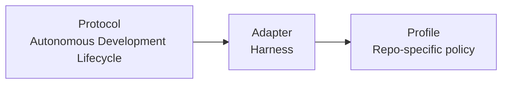
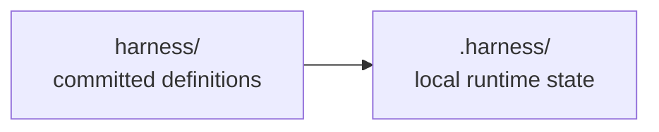
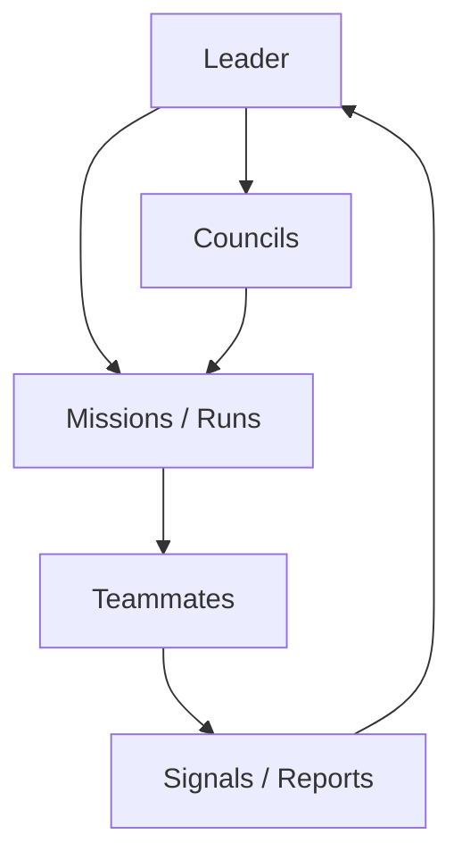
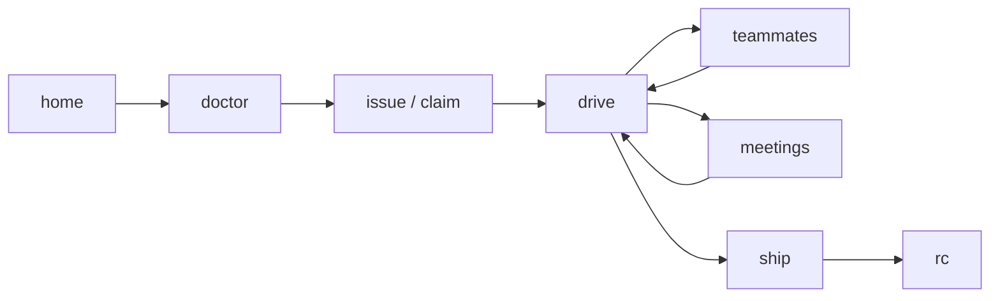

# Harness Explainer

> Status: Active
>
> Date: 2026-04-09
>
> Purpose: provide one durable, human-readable explanation of what `Harness` is, how it is designed, and how to use it without requiring readers to reconstruct the system from architecture docs, runtime code, or chat history.

---

## Harness In 30 Seconds

`Harness` is a leader-led orchestration harness for AI work.

It gives AI execution a real control plane:

- one leader that owns mission control
- bounded teammates for delegated execution
- councils for risky or ambiguous decisions
- file-backed state instead of chat-memory-only coordination
- deterministic runtime behavior outside freeform reasoning where possible

Just as important is what it is not:

- not a renamed `teamwork`
- not a renamed `wing`
- not a generic hosted cloud agent platform
- not merely “a skill”

It is a reusable Codex-native adapter package that can run inside a repo and be bootstrapped into another repo.

---

## What Problem It Solves

### Intuitive View

When AI work runs only through chat, the same failures keep showing up:

- the system forgets what was decided
- task ownership is vague
- parallel work collides
- important decisions happen implicitly
- release and follow-up work depend on operator memory

`Harness` exists to turn that fuzzy situation into governed execution.

### Engineering View

The system makes implicit things explicit:

- work becomes `missions` and `runs`
- delegation becomes first-class `teammate runs`
- ambiguity becomes `councils`
- drift becomes `doctor`, `authority-audit`, and `maintenance`
- post-decision obligations become structured adopted follow-up objects

So the main problem is not “how do we get the model to write code.”

The main problem is:

**how do we make AI execution legible, governable, resumable, and shippable?**

---

## What Harness Is

`Harness` has three identities that must stay separate.

### 1. Protocol

The protocol is the lifecycle semantics:

`issue -> claim -> drive -> ship -> rc`

### 2. Adapter

The adapter is the Codex-facing package:

- public name: `Harness`
- machine-readable adapter id: `codex-native-harness`

### 3. Profile

The profile is repo-specific policy:

- branch and release conventions
- verification commands
- workflow constraints
- local defaults

### Identity Diagram



```text
Protocol -> Harness -> Profile
```

### Definition Layer vs Runtime State

`Harness` also separates committed definitions from local runtime state.



```text
harness/  -> committed definitions
.harness/ -> local runtime state
```

That split is architectural, not cosmetic.

---

## How It Is Designed

### Intuitive View

Think of `Harness` as a project control room for AI execution.

- the leader sees the whole board
- teammates do bounded pieces of work
- councils are used when one agent should not decide alone
- signals, authority, and maintenance keep the board honest

### Core Architecture

#### Leader

The leader owns the control plane:

- issue and mission intake
- mission decomposition
- scheduling judgment
- teammate assignment
- conflict resolution
- decision escalation
- adopted truth

#### Teammates

Teammates are bounded execution units:

- they own a specific slice
- they report discoveries and blockers
- they do not silently become a second leader

#### Councils

Councils are bounded governance objects for high-risk or high-ambiguity work.

`Harness` currently supports multiple decision protocols:

- `evidence-review`
- `incident-command`
- `decision-record`

So council handling is not one universal debate ritual.

#### Missions and Runs

- `mission` = the control-plane work object
- `run` = one concrete execution attempt

This matters because the system should preserve mission-level truth even when individual runs change or fail.

#### Signals and Authority

`Harness` treats runtime truth as something that may conflict across surfaces:

- runs
- meetings
- signals
- live git state

Authority and freshness rules decide what wins.

#### Go Runtime

The shell scripts are intentionally thin.
The real deterministic control plane is the Go runtime behind:

- `cmd/harness-state/main.go`
- `internal/harness/runtime.go`

So `Harness` is not a shell-script pile.

### Operating Model Diagram



```text
Leader -> Missions/Runs -> Teammates
Leader -> Councils -> Missions/Runs
Teammates -> Signals/Reports -> Leader
```

### Why This Architecture Matters

This design gives the system properties that plain chat execution usually lacks:

- resumability
- explicit ownership
- bounded delegation
- auditable decisions
- release-aware execution
- maintenance and drift repair

---

## How The Control Plane Works

### Main Lifecycle

The protocol loop is still:

`issue -> claim -> drive -> ship -> rc`

But `Harness` surrounds that loop with more control-plane machinery.

### Practical Flow

1. `issue`
   Work starts as a real work item.
2. `claim`
   The issue becomes governed execution.
3. `drive`
   The run moves through active execution, waiting, blocking, meetings, follow-up, and completion.
4. `ship`
   PR, review, checks, merge, and cleanup become governed.
5. `rc`
   Release-candidate governance stays inside the same system.

### Surrounding Control-Plane Behavior

Around that loop, the runtime also manages:

- scheduler selection
- maintenance priority
- mission authority
- governed teammate delegation
- council orchestration
- adopted council output
- delegated adopted follow-up

That last part is important:

`Harness` no longer stops at “the council ended.”
Closed councils can generate structured output and follow-up objects that re-enter the run lifecycle and can even be delegated to teammate runs.

### Usage Flow Diagram



```text
home -> doctor -> issue/claim -> drive
drive -> teammates / meetings -> drive -> ship -> rc
```

### Current Maturity

`Harness` is already on the `1.0.0` stable line.

That means the first stable line is complete.
What remains is best understood as post-1.0 expansion, not core architectural incompleteness.

---

## How To Use It

This section covers the practical command surface, grouped by workflow instead of as a flat dump.

### 1. Install And Validate

Install the Codex skill:

```bash
./install-codex.sh harness
```

Validate the adapter/package boundary:

```bash
./scripts/harness-adapter.sh validate
```

Use this when you want to confirm:

- manifest integrity
- package boundary health
- public contract / release criteria anchors

### 2. Daily Leader Loop

Top-level leader view:

```bash
bash scripts/harness-home.sh
bash scripts/harness-home.sh --brief
```

Use `--brief` when a human wants a leader-readable summary of current focus, why it is primary, the next step, teammate state, and whether council work is now in play.

Runtime diagnosis:

```bash
bash scripts/harness-doctor.sh
bash scripts/harness-doctor.sh --brief
```

Keep the default JSON when another tool or automation needs the raw control-plane payload.

Mission control:

```bash
bash scripts/harness-missions.sh schedule --brief
bash scripts/harness-missions.sh list
bash scripts/harness-missions.sh graph --brief
bash scripts/harness-missions.sh get issue-1234 --brief
bash scripts/harness-missions.sh authority-audit issue-1234 --brief
bash scripts/harness-missions.sh authority-audit --all --brief
```

Use `schedule --brief` when a human wants the scheduler portfolio itself in readable form: what primary control-plane packet currently wins, why it wins, whether foreground execution is admitted, and what decision/maintenance/reschedule backlog still sits behind it.
Use `graph --brief` when the question is topology-level instead: which active roots and dependencies currently structure the mission graph, what is blocked behind them, and which root mission the leader should advance next.

Use `missions authority-audit --brief` when the question is not "what state is this mission in?" but "is this durable mission record still trustworthy, or is fresher/competing run activity changing who should control it?".
Use `missions authority-audit --all --brief` when the question is graph-level instead: "which overlapping mission bundle currently needs leader attention, why, and should the next step be direct leader judgment or bundle-scoped council work?".

### 3. Turn Work Into Governed Execution

Draft an issue:

```bash
bash scripts/harness-issue.sh draft "Mission title" --criteria="A|B"
```

Claim work:

```bash
bash scripts/harness-claim.sh 1234
bash scripts/harness-claim.sh 1234 --brief
```

Use `claim --brief` when a human wants the newly created mission, leader run, branch, provisioning result, contract path, and immediate next action without opening raw claim JSON.

Start the run:

```bash
bash scripts/harness-drive.sh start RUN_ID
bash scripts/harness-drive.sh start RUN_ID --brief
bash scripts/harness-drive.sh report RUN_ID "progress checkpoint" --brief
```

### 4. Drive Execution

Move run state:

```bash
bash scripts/harness-drive.sh wait RUN_ID "Waiting on dependency" --on=RUN_A
bash scripts/harness-drive.sh wait RUN_ID "Waiting on dependency" --on=RUN_A --brief
bash scripts/harness-drive.sh block RUN_ID "reason"
bash scripts/harness-drive.sh block RUN_ID "reason" --brief
bash scripts/harness-drive.sh resume RUN_ID --brief
bash scripts/harness-drive.sh complete RUN_ID "Execution complete" --brief
bash scripts/harness-drive.sh reprovision RUN_ID --mode=worktree --apply
```

Use `drive ... --brief` on `start`, `resume`, `wait`, `block`, and `complete` when a human wants the state transition, current run summary, next leader action, teammate boundary, council boundary, and emitted blocker signal if one was created.

Inspect run-level authority:

```bash
bash scripts/harness-runs.sh get RUN_ID --brief
bash scripts/harness-runs.sh authority-audit RUN_ID --brief
bash scripts/harness-runs.sh authority-audit RUN_ID
```

Use `runs authority-audit --brief` when the question is not "what is this run doing?" but "why is this run no longer trustworthy and what should leader/council/teammates do next?".

### 5. Delegate To Teammates

Assign bounded execution:

```bash
bash scripts/harness-teammates.sh assign RUN_ID worker-a implementation "Implement bounded slice"
bash scripts/harness-teammates.sh assign RUN_ID worker-a implementation "Implement bounded slice" --brief
bash scripts/harness-teammates.sh get TEAMMATE_RUN_ID --brief
```

Use `teammates assign --brief` when a human wants the delegation handoff immediately: who owns the slice, which parent run it belongs to, which contract and ownership selectors bound it, which dependencies or communication peers apply, which assignment signal was emitted, and what leader/teammate/council action comes next.
Use `teammates get --brief` when a human wants to inspect one bounded teammate object directly: what scope it owns, whether dependencies or report freshness are blocking it, what the teammate should do next, what the leader should monitor, and whether council or governed peer communication is involved.

Record teammate progress:

```bash
bash scripts/harness-teammates.sh report TEAMMATE_RUN_ID "Progress update" --kind=progress
bash scripts/harness-teammates.sh report TEAMMATE_RUN_ID "Progress update" --kind=progress --brief
bash scripts/harness-signals.sh active MISSION_ID --brief
bash scripts/harness-signals.sh adjudicate --all --brief
```

Use `teammates report --brief` when a human wants to understand a teammate status update as a governed control-plane signal: what was reported, what evidence was attached, how fresh it is, and whether the leader should adopt, resolve, or escalate the signal.
Use `signals active --brief` when the question is control-signal visibility: which active signal is currently most important, whether it is fresh, what it applies to, and whether the next move is adoption, resolution, teammate evidence, or council materialization.
Use `signals adjudicate --brief` when the question is signal repair: whether active signals were actually superseded by fresher run or meeting truth, why they were or were not resolved, and what the leader should inspect next.

Govern teammate communication:

```bash
bash scripts/harness-teammates.sh link TEAMMATE_A TEAMMATE_B "Why they may coordinate"
bash scripts/harness-teammates.sh link TEAMMATE_A TEAMMATE_B "Why they may coordinate" --brief
bash scripts/harness-teammates.sh message TEAMMATE_A TEAMMATE_B interface_change "Signature changed"
bash scripts/harness-teammates.sh message TEAMMATE_A TEAMMATE_B interface_change "Signature changed" --brief
bash scripts/harness-teammates.sh escalate TEAMMATE_RUN_ID "Do we need a decision here?" --materialize --brief
```

Use `teammates link --brief` when the leader has approved a bounded peer-communication channel and a human needs to see why the link exists, which scopes it connects, and that it does not transfer ownership or mission authority.
Use `teammates message --brief` when linked teammates need governed communication that a human can read immediately: who sent it, who received it, what signal kind it emitted, what evidence supports it, and whether the leader or a council needs to act.
Use `teammates escalate --brief` when a bounded teammate needs leader/council attention: what question is being raised, which `requires_meeting` signal was emitted, whether a council was materialized, which decision protocol applies, and what the leader should open next.

### 6. Use Councils And Meetings

Open a meeting:

```bash
bash scripts/harness-drive.sh meeting RUN_ID "What should we do here?"
bash scripts/harness-drive.sh meeting RUN_ID "What should we do here?" --brief
```

Work the meeting directly:

```bash
bash scripts/harness-meetings.sh add-participant MEETING_ID TEAMMATE_RUN_ID architecture-challenger
bash scripts/harness-meetings.sh lock-decision MEETING_ID "Keep this council scoped to the concrete decision." --reason="Avoid widening council scope." --authority=L2 --evidence=harness/profiles/erwin.yml
bash scripts/harness-meetings.sh lock-decision MEETING_ID "Keep this council scoped to the concrete decision." --reason="Avoid widening council scope." --authority=L2 --evidence=harness/profiles/erwin.yml --brief
bash scripts/harness-meetings.sh add-position MEETING_ID TEAMMATE_RUN_ID independent_review support "Bounded evidence summary." --claim=decision-claim --dimension=factual --evidence=docs/spec.md
bash scripts/harness-meetings.sh add-position MEETING_ID TEAMMATE_RUN_ID independent_review support "Bounded evidence summary." --claim=decision-claim --dimension=factual --evidence=docs/spec.md --brief
bash scripts/harness-meetings.sh add-finding MEETING_ID accepted "Bounded judgment summary." --reason="Evidence supports this claim." --authority=L2 --evidence=docs/spec.md --claim=decision-claim --dimension=factual
bash scripts/harness-meetings.sh add-finding MEETING_ID accepted "Bounded judgment summary." --reason="Evidence supports this claim." --authority=L2 --evidence=docs/spec.md --claim=decision-claim --dimension=factual --brief
bash scripts/harness-meetings.sh add-action MEETING_ID "Bounded follow-up action."
bash scripts/harness-meetings.sh add-action MEETING_ID "Bounded follow-up action." --brief
bash scripts/harness-meetings.sh resolve-action MEETING_ID ACTION_ID done
bash scripts/harness-meetings.sh resolve-action MEETING_ID ACTION_ID done --brief
bash scripts/harness-meetings.sh orchestrate MEETING_ID
bash scripts/harness-meetings.sh orchestrate MEETING_ID --brief
bash scripts/harness-meetings.sh summary MEETING_ID
bash scripts/harness-meetings.sh summary MEETING_ID --brief
bash scripts/harness-meetings.sh authority-audit MEETING_ID --brief
bash scripts/harness-meetings.sh authority-audit MEETING_ID
```

Use `drive meeting --brief` when a leader opens a council and wants the created meeting id, host run, protocol, backlog ref, and the exact `meetings summary/orchestrate --brief` follow-up path before drilling into raw JSON.
Use `--brief` when a human wants the meeting phase, blocking reason, current council work packet, protocol-aware output state, and next leader/council action without reopening raw meeting JSON.
Use `meetings lock-decision --brief` when the human has just bounded council scope and needs to know what was locked, why that is the current decision surface, and what leader/teammate/council action comes next.
Use `meetings add-position --brief` when the human or teammate has just recorded a council position and needs to know what claim/phase it affected, whether more independent review or debate is still owed, and who should act next.
Use `meetings add-finding --brief` when the human has just recorded council judgment and needs to know whether that finding is accepted/rejected/unresolved, whether rejected-finding governance or same-claim authority repair is still needed, and what should happen before output/adoption.
Use `meetings add-action --brief` when the human has just recorded a council action item and needs to know what was added, who owns the next step, whether a teammate assignment is still needed, and what must happen before adoption or output.
Use `meetings resolve-action --brief` when the human has just closed, cancelled, or reopened a council action and needs to know whether adopted follow-up packets and run guidance were synchronized.
Use `meetings orchestrate --brief` when the human has just asked the council chair to advance or refresh orchestration and needs to know what changed, why it advanced or stayed put, and which leader/council work packet is next.
Use `meetings authority-audit --brief` when the question is narrower: whether same-claim findings inside the council already have a governed winner or still need explicit judgment.

Close or adopt outcomes:

```bash
bash scripts/harness-drive.sh meeting-close RUN_ID MEETING_ID "resolution"
bash scripts/harness-drive.sh meeting-close RUN_ID MEETING_ID "resolution" --brief
bash scripts/harness-drive.sh adopt-meeting RUN_ID MEETING_ID
bash scripts/harness-drive.sh adopt-meeting RUN_ID MEETING_ID --brief
```

Use `drive meeting-close --brief` or `drive adopt-meeting --brief` when a human needs to see what council outcome was written back into the run, whether structured output or follow-up packets were adopted, and whether any bundle-governor authority signal was created.

### 7. Work Adopted Follow-Up

Closed councils can produce structured follow-up that re-enters execution.

Resolve follow-up directly:

```bash
bash scripts/harness-drive.sh resolve-follow-up RUN_ID
bash scripts/harness-drive.sh resolve-follow-up RUN_ID FOLLOW_UP_PACKET_ID done --brief
```

Delegate adopted follow-up:

```bash
bash scripts/harness-teammates.sh assign RUN_ID worker-b implementation "Bounded follow-up" --adopted-follow-up
```

### 8. Ship And Merge

Verify ship readiness:

```bash
bash scripts/harness-ship.sh verify RUN_ID "targeted-check:pass"
```

Push and open PR flow:

```bash
bash scripts/harness-ship.sh push RUN_ID
bash scripts/harness-ship.sh pr-draft RUN_ID
bash scripts/harness-ship.sh pr-open RUN_ID --draft
```

Record review/check/merge state:

```bash
bash scripts/harness-ship.sh review RUN_ID approved "Approved after fixes"
bash scripts/harness-ship.sh checks RUN_ID passed "ci:passed"
bash scripts/harness-ship.sh merge RUN_ID --via=git "Merged cleanly"
bash scripts/harness-ship.sh cleanup RUN_ID --delete-branch
```

### 9. Release Candidates

RC lifecycle:

```bash
bash scripts/harness-rc.sh create v1.2.3 RUN_ID
bash scripts/harness-rc.sh verify RC_ID "verification note"
bash scripts/harness-rc.sh promote RC_ID "promotion note"
```

High-friction release handling:

```bash
bash scripts/harness-rc.sh fix RC_ID COMMITISH --apply --push
bash scripts/harness-rc.sh cancel RC_ID "reason" --apply
bash scripts/harness-rc.sh hotfix v1.2.4 COMMITISH --apply --push
bash scripts/harness-rc.sh backport v1.2.4 COMMITISH --apply --push
```

### 10. Maintenance, Packaging, And Reuse

Reconcile or normalize runtime state:

```bash
bash scripts/harness-maintenance.sh reconcile
bash scripts/harness-maintenance.sh reconcile --brief
bash scripts/harness-maintenance.sh normalize
bash scripts/harness-maintenance.sh normalize --brief
```

Use `maintenance reconcile --brief` when a human wants the repair result first: which orphaned or superseded signals and orphaned meetings were cleaned up, why reconciliation did or did not change state, and what health check should happen next.
Use `maintenance normalize --brief` when a human wants the migration result first: which older run, signal, or contract records were upgraded into current runtime shape, why no-op normalization changed nothing, and what health check should happen next.

Build or package the runtime:

```bash
bash scripts/harness-build-runtime.sh
bash scripts/harness-package-runtime.sh
```

Bootstrap into another repo:

```bash
bash scripts/harness-bootstrap.sh /path/to/target-repo
bash scripts/harness-sync.sh
bash scripts/harness-sync.sh status
```

Inspect additional stable surfaces when needed:

```bash
bash scripts/harness-profile.sh
bash scripts/harness-contracts.sh
bash scripts/harness-signals.sh
bash scripts/harness-git.sh
```

Run verification:

```bash
./scripts/harness-issue-smoke-test.sh
./scripts/harness-smoke-test.sh
./scripts/harness-release-smoke-test.sh
./scripts/harness-teammate-smoke-test.sh
./scripts/harness-runtime-dist-smoke-test.sh
./scripts/harness-runtime-package-smoke-test.sh
./scripts/harness-bootstrap-smoke-test.sh
./scripts/harness-all-smoke-test.sh
```

---

## How To Read The Rest Of The Docs

If you want the whole system explained at different depths, use this order:

1. [docs/harness-explainer.md](harness-explainer.md)
2. [docs/harness-documentation-map.md](harness-documentation-map.md)
3. [docs/harness-architecture.md](harness-architecture.md)
4. [docs/harness-operating-model.md](harness-operating-model.md)
5. [docs/harness-public-contract.md](harness-public-contract.md)
6. [harness/README.md](../harness/README.md)
7. [skills/harness/README.md](../skills/harness/README.md)

---

## Final Mental Model

If you only keep one picture in your head, keep this one:

`Harness` is the thing that makes AI work governable.

Not just generative.
Not just conversational.
Not just “multi-agent.”

Governable:

- visible
- resumable
- delegated
- audited
- decision-aware
- release-aware

That is what it is for.
